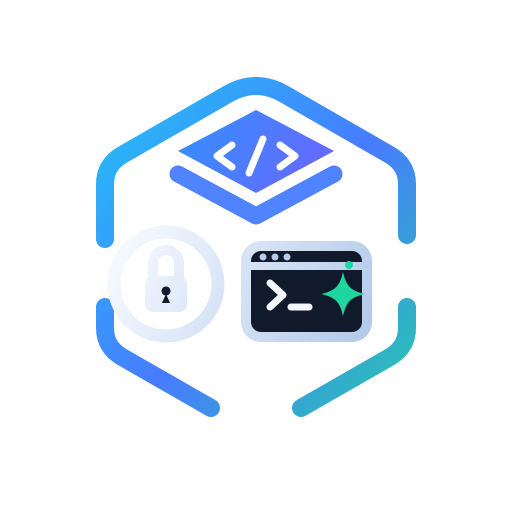

<p align="center"></p>

# Claude Launcher

App de escritorio para organizar tus proyectos y repositorios, guardar sus secretos en una bóveda KeePass y abrir sesiones de [Claude Code](https://docs.claude.com/en/docs/claude-code) con las variables de entorno correctas en un clic.

> Estado: uso personal, solo **Windows**. Web: https://bytewareteam.github.io/claude-launcher/

## Funciones

- **Proyectos y repos**: agrupa varios repositorios git bajo un proyecto.
- **Worktrees**: lista los worktrees de cada repo, sus cambios sin commitear y los commits que llevan por delante de la rama base. Abre Claude en cualquiera o elimínalos.
- **Bóveda de secretos**: variables de entorno por proyecto y por repo, guardadas en un archivo `.kdbx` (compatible con KeePassXC). Importa desde `.env`. Se bloquea sola a los 15 minutos.
- **Lanzar Claude**: abre una pestaña de Windows Terminal en la carpeta elegida con `claude` y solo las variables de ese proyecto/repo (más las imprescindibles del sistema).
- **Inicio**: resumen de actividad, sesiones recientes y avisos de worktrees con cambios.
- **Búsqueda global**: `Ctrl+K` (`⌘K` en Mac) para buscar proyectos, repos, worktrees y sesiones.

## Requisitos

- Windows 10/11
- [Node.js](https://nodejs.org) 20 o superior
- [Git](https://git-scm.com)
- [Claude Code](https://docs.claude.com/en/docs/claude-code) instalado y disponible como `claude` en el `PATH`
- [Windows Terminal](https://aka.ms/terminal) (recomendado; si no está, usa `cmd`)

## Instalación

```bash
git clone https://github.com/bytewareteam/claude-launcher.git
cd claude-launcher
npm install
npm run dev
```

### Generar el ejecutable

```bash
npx nx run claude-launcher:package       # solo portable
npx nx run claude-launcher:package:all   # instalador NSIS + portable
```

Se genera en `apps/claude-launcher/dist/`.

## Descargas y versiones

Cada versión publicada está en [Releases](https://github.com/bytewareteam/claude-launcher/releases) con el `.exe` portable (no requiere instalación). Las versiones siguen [semver](https://semver.org/lang/es/) y se publican al integrar una rama `release/*` en `main`, con la versión calculada a partir de los mensajes de commit; los cambios están en [CHANGELOG.md](CHANGELOG.md).

## Seguridad

- Los secretos viven cifrados en un archivo KeePass (KDBX 4, Argon2id) protegido por tu contraseña maestra.
- Se pasan a Claude por **variables de entorno**, nunca por línea de comandos.
- La terminal solo hereda una lista blanca de variables del sistema: los tokens que tengas en tu entorno global no llegan al agente.
- Al copiar un secreto, el portapapeles se limpia a los 30 segundos.

Tus datos se guardan en `%APPDATA%\claude-launcher\` (`data.json` y `secrets.kdbx`). No se envía nada a ningún servidor.

## Stack

Nx · Electron · electron-vite · React 19 · Tailwind CSS v4 · shadcn/ui · TanStack Query · kdbxweb

## Contribuir

Lee [AGENTS.md](AGENTS.md) para la arquitectura y las convenciones del código.

## Licencia

[MIT](LICENSE)
